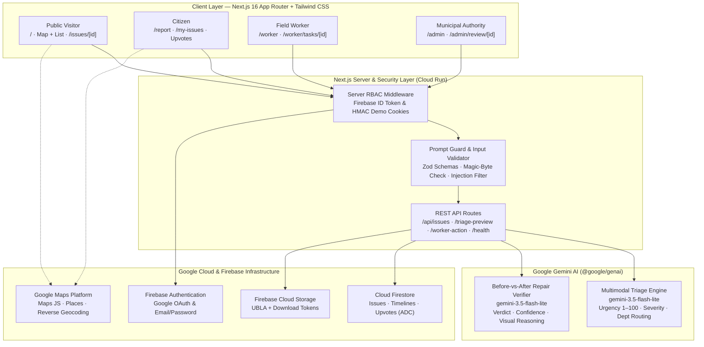

# CivicResolve

> **AI-Powered Closed-Loop Civic Issue Reporting, Verification & Municipal Accountability Platform**

[](https://nextjs.org/)
[](https://www.typescriptlang.org/)
[](https://ai.google.dev/)
[](https://firebase.google.com/)
[](https://cloud.google.com/run)
[](https://www.w3.org/WAI/standards-guidelines/wcag/)

**Live Demo:** `[YOUR_CLOUD_RUN_URL]` *(Includes one-click **Demo Citizen**, **Demo Field Worker**, and **Demo Authority** access inside the portal)*

---

## Overview & How It Works

**CivicResolve** bridges the gap between **Citizens**, **Field Workers**, and **Municipal Authorities** in a transparent, AI-verified 4-stage accountability loop. Unlike traditional complaint boxes where tickets disappear after submission, CivicResolve uses multimodal **Google Gemini AI** twice—first to score criticality and route incoming hazards, and second to visually inspect on-site repair proof before an authority closes the ticket.

### The 4-Stage Closed-Loop Workflow

1. **Reported (Citizen → Gemini AI Triage):** A signed-in citizen pins a hazard on Google Maps, describes the issue, and uploads photo evidence. Gemini AI analyzes the text and image together to calculate a `1–100` urgency score, assign severity (`Low` → `Critical`), and route the ticket to the right municipal department.
2. **In Progress (Field Worker):** Pre-authorized field crews view ongoing tasks in their dedicated `/worker` portal, open Google Maps directions, and mark on-site repair work as started.
3. **Pending Verification (Field Worker → Gemini AI Inspection):** After completing the fix, the worker uploads an **After-Repair proof photo** and summary. Gemini AI compares the original complaint and "Before" photo against the "After" photo to generate an automated verification verdict (`Verified Fixed`, `Partially Fixed`, or `Needs Re-Inspection`) and notifies the Municipal Authority.
4. **Resolved (Municipal Authority Sign-Off):** Authorities review the side-by-side **Before vs. After** photos alongside Gemini's verification report on `/admin/review/[id]` and either **Approve & Mark Resolved** (publishing proof to the public timeline) or **Request Rework** (sending the task back to the field worker's queue).

---

## System Architecture



### Tech Stack

| Layer | Technology |
| :--- | :--- |
| **Framework & Language** | Next.js 16 (App Router, Turbopack, Standalone Output), TypeScript, Tailwind CSS |
| **Multimodal AI** | Google Gemini (`gemini-3.5-flash-lite` via `@google/genai`) with structured JSON schemas |
| **Database & Storage** | Firebase Cloud Firestore & Cloud Storage (Admin SDK via Application Default Credentials) |
| **Authentication** | Firebase Auth (Google Sign-In + Email/Password) + Signed `HttpOnly` Evaluator Sessions |
| **Geospatial** | Google Maps JavaScript API, Places Autocomplete, and Geocoding API (Reverse Geocoding) |
| **Testing & Quality** | Vitest (Unit), `vitest-axe` (WCAG 2.1 AA A11y), Playwright (Full-Loop E2E), ESLint |
| **Deployment & CI/CD** | Docker (Multi-Stage Standalone), Google Cloud Run, GitHub Actions |

---

## Critical Features

### 1. AI-Driven Issue Criticality & Multimodal Repair Verification

CivicResolve uses **`gemini-3.5-flash-lite`** via structured JSON output (`responseMimeType: "application/json"` + strict `responseSchema`) to eliminate manual triage bottlenecks and prevent unverified ticket closures:

* **Multimodal Criticality Scoring (`1–100`):** When a citizen reports a hazard, Gemini evaluates the **title, description, location context, and uploaded photo simultaneously**—detecting real-world safety risks (such as exposed electrical wires, flooded storm drains, or dark arterial signal blackouts) rather than relying on naive keyword matching.
* **Structured Severity Bands & Automatic Department Routing:**
  * **Critical (`90–100`):** Immediate public safety hazards requiring urgent dispatch (`< 4 hours` SLA).
  * **High (`70–89`):** Major infrastructure disruptions impacting commuters or utilities.
  * **Medium (`40–69`):** Localized hazards or maintenance needs.
  * **Low (`1–39`):** Minor wear or non-urgent upkeep.
  * Automatically maps each issue to the right municipal unit (e.g., *Transportation & Traffic Engineering*, *Water & Drainage*, *Street Lighting & Power*, *Public Works*, *Parks & Forestry*) with a transparent **Confidence %**, **Estimated Impact**, and **AI Reasoning** displayed publicly on every issue card.
* **Before-vs-After AI Repair Verification:** When a Field Worker uploads an after-repair photo, Gemini receives both the original issue context/"Before" image and the worker's "After" photo to output a structured verdict (`Verified Fixed`, `Partially Fixed`, or `Needs Re-Inspection`), confidence score, visual comparison summary, and recommended action (`Approve Resolution` vs. `Request Rework`).
* **Graceful Deterministic Fallback:** If the Gemini API is rate-limited or unreachable, the backend falls back cleanly to a deterministic triage/verification engine so civic operations never break.

### 2. Core Platform Features

* **Strict 3-Role Access Portal & Public Transparency:**
  * **Public Transparency Feed (`/`):** Open read-only dashboard showing live issue counts, a full-width **Split View (`Map + List`)** alongside `Map Only` and `List Only` modes, and one-click **Open Data CSV / JSON Exports**.
  * **Citizen Portal (`/report`, `/my-issues`):** Report issues with real-time AI triage previews, toggle persistent upvotes (1 per user), and monitor personal submissions across all 4 lifecycle stages.
  * **Field Worker Portal (`/worker`, `/worker/tasks/[id]`):** Focused operational queue restricted strictly to ongoing tasks (`Reported` & `In Progress`)—workers cannot submit new citizen complaints. Supports one-click `Start On-Site Work`, Google Maps turn-by-turn links, live proof-photo previews, and instant Gemini AI report generation.
  * **Municipal Authority Console (`/admin`, `/admin/review/[id]`):** Urgency-sorted dispatch queue (`Highest Criticality First`), highlighted **Pending Verification** alert notifications, dedicated Before-vs-After approval review screen, quick-fill resolution note chips, and accessible segmented status/priority controls.
* **Regional Cascading Filters (`State → City`) & Live Geospatial Sync:**
  * Filter issues by **State** and **City** across India, dynamically recalculating KPI stats and auto-panning/fitting the interactive Google Map to matching pins.
  * Clicking the map, dragging the pin, or tapping **Use My Location** triggers live **Reverse Geocoding** to auto-fill street address, district/locality, city, and state automatically.
* **WCAG 2.1 AA Accessibility:** Engineered with keyboard-first navigation, `"Skip to main content"` landmarks, visible focus rings, `role="radiogroup"` semantics, and automated `vitest-axe` verification.

---

## Security & Privacy Architecture

CivicResolve is built with defense-in-depth across AI prompts, authentication, API routes, and cloud storage:

* **Prompt Encapsulation & Prompt-Injection Defense (`promptGuard.ts`):**
  * All AI behavioral rules are isolated inside `@google/genai`'s dedicated **`systemInstruction`** parameter—never concatenated directly with user strings.
  * Untrusted citizen reports and worker notes are sanitized and wrapped inside strict XML boundary tags (`<untrusted_citizen_report>` / `<untrusted_worker_note>`), stripping closing-tag mimicry.
  * A layered deterministic pre-scanner plus Gemini schema validation (`isValidCivicIssue`, `promptInjectionDetected`) blocks jailbreaks, instruction overrides, and off-topic Q&A prompts (e.g., `"solve this problem what is 1+1"`) with HTTP `400` so spam never enters Firestore or tricks the criticality scorer.
* **Strict Server-Side RBAC & Session Integrity:**
  * Every mutation endpoint verifies caller identity server-side via Firebase Admin ID Tokens or HMAC-signed `HttpOnly` evaluator cookies (`SameSite=Lax`).
  * `POST /api/issues` allows Citizens only (`401` unauthenticated, `403` Field Workers); `POST /api/issues/[id]/worker-action` allows Field Workers only (`403` Citizens/Authorities); `PATCH /api/issues/[id]` allows pre-authorized Municipal Authorities only (`ADMIN_EMAILS`).
  * No open self-registration for Field Worker or Authority roles—elevated roles are strictly pre-authorized via server allowlists (`WORKER_EMAILS`, `ADMIN_EMAILS`).
* **Zero-Secret Client Exposure & Keyless Cloud IAM:**
  * `GEMINI_API_KEY` lives exclusively on the server and is never bundled or transmitted to the browser.
  * Firebase Admin SDK authenticates via **Application Default Credentials (ADC)** locally and an attached least-privilege **Cloud Run IAM Service Account** in production—zero static service-account JSON key files in the repository.
  * Public API responses strip reporter email addresses to prevent PII exposure.
* **Upload, Storage & Network Hardening:**
  * Image uploads enforce a `5 MB` cap and **server-side magic-byte validation** (JPEG, PNG, WebP) to reject spoofed file extensions.
  * Before-photo fetching for Gemini comparison enforces **SSRF guards** restricting requests to trusted storage hosts.
  * Firebase Cloud Storage operates with **Uniform Bucket-Level Access (UBLA)** using scoped `firebaseStorageDownloadTokens`, paired with strict `firestore.rules`, `storage.rules`, and hardened Next.js **Content Security Policy (CSP)** headers.

---

## Local Setup & Development

### Prerequisites
* Node.js `20+`
* Google Cloud CLI (`gcloud`) authenticated with Application Default Credentials:
  ```bash
  gcloud auth application-default login
  ```
* Firebase project (Auth, Firestore, Cloud Storage) & Google Maps API key (Maps JS, Places, Geocoding)

### Installation

```bash
# 1. Clone and install dependencies
git clone [https://github.com/](https://github.com/)<your-username>/civic-resolve.git
cd civic-resolve
npm install

# 2. Configure environment variables
cp .env.example .env.local
# Populate GEMINI_API_KEY, GOOGLE_CLOUD_PROJECT, NEXT_PUBLIC_FIREBASE_*,
# NEXT_PUBLIC_GOOGLE_MAPS_API_KEY, ADMIN_EMAILS, WORKER_EMAILS, and DEMO_ADMIN_SESSION_SECRET

# 3. Seed realistic multi-state Firestore issues
npx tsx --env-file=.env.local scripts/seed.ts

# 4. Run the development server
npm run dev
```

Open `http://localhost:3000` in your browser.

---

## Verification & Quality Checks

```bash
npm run lint          # ESLint (0 errors, 0 warnings)
npm run typecheck     # Strict TypeScript compilation check
npm test              # Vitest unit, RBAC, prompt-guard & vitest-axe WCAG a11y suite
npm run test:e2e      # Playwright full closed-loop Citizen -> Worker -> Authority E2E suite
npm run build         # Production Next.js standalone build
```
