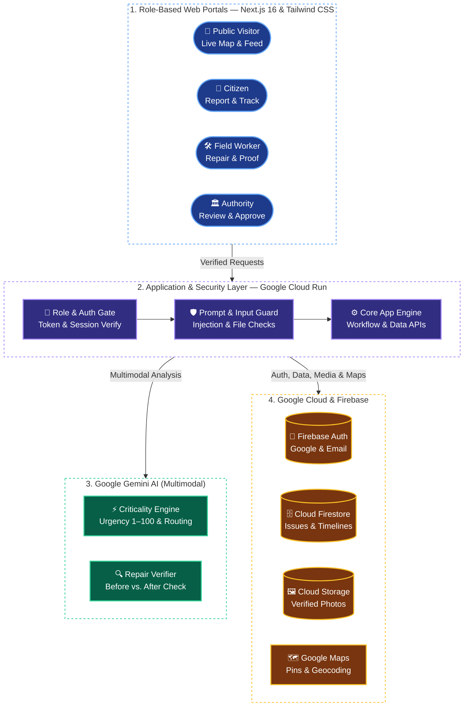

# CivicResolve

> **AI-Powered Closed-Loop Civic Issue Reporting, Repair Verification & Municipal Accountability Platform**

[](https://nextjs.org/)
[](https://www.typescriptlang.org/)
[](https://ai.google.dev/)
[](https://firebase.google.com/)
[](https://cloud.google.com/run)
[](https://www.w3.org/WAI/standards-guidelines/wcag/)

**Live Demo:** `[YOUR_CLOUD_RUN_URL]`  
*(Includes one-click **Demo Citizen**, **Demo Field Worker**, and **Demo Authority** logins so anyone can experience all three roles instantly.)*

---

## What Is CivicResolve?

**CivicResolve** connects **Citizens**, **Field Workers**, and **Municipal Authorities** in a transparent, end-to-end accountability loop.

In most civic complaint portals, reports disappear into a black hole after submission. CivicResolve closes that loop using **Google Gemini AI** at two critical checkpoints: first to judge how urgent a newly reported hazard is and route it to the right department, and second to visually compare **Before vs. After** repair photos before an official marks the issue resolved.

### How the 4-Stage Workflow Works

1. **Reported — Citizen & Gemini AI Triage**  
   A citizen pins the hazard on Google Maps, describes the problem, and uploads a photo. Gemini AI inspects the text and photo together, assigns an urgency score (`1–100`), sets the severity level, and routes the report to the responsible municipal department.
2. **In Progress — Field Worker Dispatch**  
   Pre-authorized field workers view ongoing tasks in the **Field Worker Portal**, open Google Maps directions to the site, and mark on-site repair work as started.
3. **Pending Verification — AI Repair Inspection**  
   Once the fix is complete, the worker uploads an **After-Repair proof photo** and short summary. Gemini AI compares the original complaint and "Before" photo against the "After" photo, generates a verification verdict, and alerts the Municipal Authority.
4. **Resolved — Municipal Authority Sign-Off**  
   Authorities open the **Completion Review Screen** to inspect the side-by-side **Before vs. After** photos alongside Gemini's verification report. They can either **Approve & Mark Resolved** (publishing verified proof to the public timeline) or **Request Rework** (sending the task back to the field worker).

---

## System Architecture



### Tech Stack

| Layer | Technologies Used |
| :--- | :--- |
| **Frontend & App Framework** | Next.js 16 (App Router), TypeScript, Tailwind CSS |
| **Multimodal AI** | Google Gemini (`gemini-3.5-flash-lite`) with structured JSON outputs |
| **Database & File Storage** | Firebase Cloud Firestore & Cloud Storage |
| **Authentication** | Firebase Authentication (Google Sign-In & Email/Password) + Signed Evaluator Sessions |
| **Maps & Geolocation** | Google Maps JavaScript API, Places Autocomplete & Reverse Geocoding |
| **Quality & Accessibility** | Vitest (Unit Tests), `vitest-axe` (WCAG 2.1 AA), Playwright (End-to-End Tests) |
| **Cloud Deployment** | Docker, Google Cloud Run & GitHub Actions CI/CD |

---

## Critical Features

### 1. AI-Driven Criticality Scoring & Automated Repair Verification

Instead of relying on manual sorting or simple keyword matching, CivicResolve uses **Google Gemini (`gemini-3.5-flash-lite`)** to understand real-world safety hazards from both text and images:

* **Multimodal Hazard Analysis:** Gemini reads the issue title, description, street context, and uploaded photo together—spotting real dangers like exposed electrical wires, flooded drains, or blacked-out traffic signals.
* **Automatic Urgency & Department Routing:** Every report receives an urgency score (`1–100`), a confidence percentage, a public AI reasoning summary, and automatic assignment to the right municipal unit (*Transportation & Traffic*, *Water & Drainage*, *Street Lighting & Power*, *Public Works*, or *Parks & Forestry*).

| Urgency Score | Severity Level | Municipal Response Priority |
| :---: | :--- | :--- |
| **90 – 100** | 🔴 **Critical** | Immediate safety hazard — urgent dispatch (`< 4 hours` SLA) |
| **70 – 89** | 🟠 **High** | Major disruption to traffic, utilities, or daily commuters |
| **40 – 69** | 🟡 **Medium** | Localized infrastructure damage or routine public hazard |
| **1 – 39** | 🟢 **Low** | Minor wear, cosmetic issues, or non-urgent maintenance |

* **Before-vs-After AI Repair Verification:** When a field worker uploads proof of completion, Gemini visually compares the original complaint and "Before" photo against the new "After" photo. It outputs a clear verdict (**Verified Fixed**, **Partially Fixed**, or **Needs Re-Inspection**), confidence score, and recommendation (**Approve Resolution** vs. **Request Rework**).
* **Always-On Reliability:** If the AI service is ever rate-limited or temporarily unavailable, a built-in deterministic fallback keeps triage and field workflows running smoothly.

---

### 2. Core Platform Capabilities

#### Clean Role-Based Experience

| Role | What They See & Do |
| :--- | :--- |
| **Public Visitor** | Open read-only **Public Tracking Dashboard** with live counters, full-width **Map + List Split View**, regional filters, issue timelines, and one-click **CSV / JSON Open Data Exports**. |
| **Citizen** | Submit new reports with live Gemini AI triage previews, upvote community hazards (once per user), and track personal submissions in **My Reported Issues**. |
| **Field Worker** | Focused **Field Worker Portal** restricted strictly to ongoing repairs (cannot file citizen complaints). Includes Google Maps directions, one-click work-start tracking, live proof-photo preview, and instant AI verification report generation. |
| **Municipal Authority** | Urgency-sorted **Authority Operations Console** with highlighted **Pending Approval** alerts, a dedicated **Before-vs-After Review Screen**, quick-fill resolution notes, and one-tap status/priority controls. |

#### Smart Location & Regional Filtering
* **State → City Cascading Filters:** Narrow issues by State and City across India; KPI stats recalculate immediately and the interactive Google Map automatically pans and zooms to fit the selected region.
* **Automatic Reverse Geocoding:** Clicking the map, dragging the pin, or tapping **Use My Location** automatically fills in the street address, locality/district, city, and state.

#### Built-In Accessibility
* Designed to **WCAG 2.1 AA** standards with full keyboard navigation, `"Skip to main content"` shortcuts, clear focus indicators, accessible control groups, and automated accessibility testing.

---

## Security & Privacy

CivicResolve is engineered with layered defenses across AI prompts, user roles, file uploads, and cloud infrastructure:

* **AI Prompt Encapsulation & Injection Defense:**  
  System rules are strictly separated from user inputs using Gemini's dedicated system instruction channel. Citizen reports and worker notes are sanitized and wrapped inside strict data boundaries. A combined pre-scanner and AI schema check automatically blocks jailbreak attempts and off-topic prompts (such as math or trivia questions) so spam never enters the database or manipulates urgency scores.
* **Strict Server-Side Role Enforcement:**  
  Every protected action is verified on the server using Firebase ID Tokens or cryptographically signed `HttpOnly` demo cookies. Citizens cannot access Field Worker or Authority actions, Field Workers cannot submit citizen complaints or approve their own work, and elevated roles are strictly pre-authorized via server allowlists—never open self-registration.
* **Zero Exposed Secrets & Keyless Cloud Auth:**  
  The Gemini API key stays strictly on the server and never reaches the browser. Backend services authenticate to Firebase and Google Cloud using **Application Default Credentials** locally and a least-privilege **Cloud Run Service Account** in production—with zero static secret key files in the repository. Public issue feeds also strip reporter email addresses to protect citizen privacy.
* **Safe File Uploads & Storage Hardening:**  
  Uploaded photos enforce a `5 MB` size limit and server-side file-signature (magic-byte) validation to accept only genuine JPEG, PNG, and WebP images. Cloud Storage uses **Uniform Bucket-Level Access** with scoped download tokens, backed by strict database security rules, SSRF guards, and hardened Content Security Policy (CSP) headers.

---

## Local Setup & Running Tests

### Prerequisites
* **Node.js 20+** and **Google Cloud CLI (`gcloud`)**
* Authenticated local Google Cloud credentials (`gcloud auth application-default login`)
* Firebase project (Auth, Firestore, Storage) & Google Maps API key (Maps JS, Places, Geocoding)

### Quick Start

```bash
# 1. Clone the repository and install dependencies
git clone [https://github.com/kalyaansk/civic-resolve.git](https://github.com/kalyaansk/civic-resolve.git)
cd civic-resolve
npm install

# 2. Configure environment variables
cp .env.example .env.local
# Fill in your Gemini, Firebase, Google Maps, and Role Allowlist variables

# 3. Seed realistic multi-state sample issues into Firestore
npx tsx --env-file=.env.local scripts/seed.ts

# 4. Launch the development server
npm run dev
```

### Verification Suite

```bash
npm run lint          # Code quality & style checks
npm run typecheck     # Strict TypeScript verification
npm test              # Unit, RBAC, prompt-guard & WCAG accessibility tests
npm run test:e2e      # Full Playwright Citizen -> Worker -> Authority end-to-end tests
npm run build         # Production standalone build check
```
